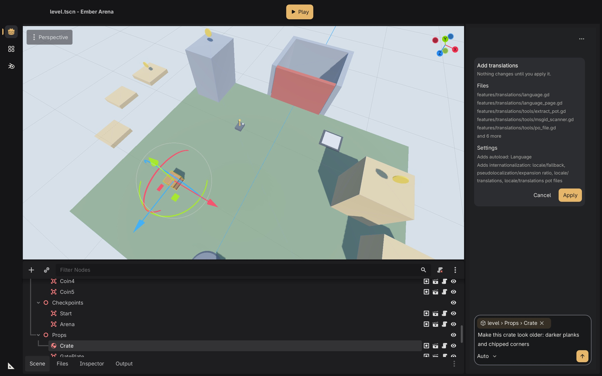

# Joinery

**Made in the Joinery, not generated.**



*A hammer modelled in Blender through chat, reviewed and placed in the scene.*

Joinery is a game editor built on Godot 4.7 that you direct by chatting with it.
You select something, say what should change, and the AI sidebar, **Journeyman**,
does the work inside a real creative tool: it models in Blender, paints in Krita,
designs a sound in Surge XT. You see a before and after, then accept or reject it.

Nothing is made by image, 3D or audio generators. Every asset is built in a real
tool, kept as an editable source file, and comes with a recipe that rebuilds it
exactly.

## How it works

1. **You ask.** "Make the hammer handle longer", "a darker door creak", "add a
   health bar". You can point at the object, material or sound you mean.
2. **The right tool does the work.** Journeyman opens the owning program
   (Blender, Krita, Material Maker, Inkscape, SuperCollider or Surge XT) in an
   offline sandbox and edits the source file there.
3. **You review.** The change is staged, never applied straight away. You get a
   preview of the model, image or sound plus the file changes.
4. **You decide.** Accept keeps it, with undo. Reject restores everything, even
   when several tools were involved.

Before any art or audio is made, each game gets an **art bible**: palette, style,
budgets and sound. You approve it, and changes are checked against it before you
see them: colours against the palette, triangle counts against budgets, and
loudness against targets.

## Creative tools

| Area | Tools Joinery works in |
|---|---|
| 3D models | Blender |
| Materials | Material Maker, Blender shader nodes |
| 2D and UI art | Krita (pixel art too), GIMP, Inkscape |
| Sound and music | Surge XT, SuperCollider; music as MIDI rendered through FluidSynth and Surge XT |
| The game itself | Godot scenes, scripts and settings |

GIMP 3 edits native .xcf images (named layers, saved selection channels) in
the offline worker through Joinery's own Python-Fu adapter and exports
byte-identical PNGs. Audacity still opens sound files when it is installed.
Aseprite, REAPER, MuseScore and Audacity are no longer built-in tools
([ADR 0025](docs/adr/0025-tool-removals.md)); you can add them, or any other
program, as your own custom tool. The [support matrix](docs/support-matrix.md)
shows exactly what works for each tool.

## Bring your own AI

Joinery works with **Claude Code, Codex, Gemini CLI or opencode**, using your own
subscription or API key. Subscriptions sign in through each agent's own login;
API keys stay in a private file on your machine, outside your projects. The same
creation-only rules apply whichever agent you pick.

So far Codex is the one tested live end to end. On Windows this alpha supports
Codex only; on macOS and Linux the others are supported but not yet verified live.

## Status

**0.1 alpha.** Builds for macOS (Apple Silicon), Linux and Windows pass their
editor, review, undo and exported-game checks. It is early software: expect rough
edges, and read the [release notes](docs/releases/0.1.0-alpha.1.md) first.

You need **uv, Docker, Git, Node.js and a signed-in agent CLI** (or an API key).
The first setup downloads several GB of tools; after that, the creative tools run
with networking switched off.

## Quick start

```sh
uv sync --frozen
uv run joinery new ~/games/my-game --name "My Game" --tools godot,blender \
  --blueprint first-person-3d --features controller,save-load
uv run joinery bootstrap --project ~/games/my-game
uv run joinery launch --project ~/games/my-game
```

`--blueprint` starts from a small playable game (leave it out for an empty
project); `joinery blueprints` lists them and `joinery features` what a game can
add, such as controller support, saving, online play, Steam or translations.
With Steam, add `--steam-app-id N` (or leave it out to add it later); Joinery
downloads the pinned GodotSteam extension and never publishes anything.
The Project Manager's **New project** wizard asks the same questions.

Then, in the editor:

- Project setup asks a few questions and drafts your art bible; type `/art` to
  review and approve it.
- Ask Journeyman for something, for example "make a low-poly wooden crate".
- Review the preview and press **Accept** or **Discard**.
- Type `/` to see every command, or `/help`. `/feature add <id>` plans a
  feature change and applies it only when you press Apply.

Projects stay plain Godot projects, so they open in stock Godot too.

## Commands

| Command | What it does |
|---|---|
| `joinery new PATH [--blueprint ID --features a,b]` | Make a project, the same one the new-project wizard makes |
| `joinery blueprints [describe ID] [--json]`, `joinery features` | The starting points and the features a game can add |
| `joinery feature add\|remove\|list ID --project P [--plan]` | Add or remove a feature as a reviewed change |
| `joinery setup --project P` | Change a project's tools |
| `joinery bootstrap --project P` | Install the pinned tool servers and offline workers |
| `joinery status --project P`, `joinery doctor` | What each tool can do right now |
| `joinery connect status\|verify --agent ID` | Is the agent signed in, and does it really answer |
| `joinery brief --project P`, `joinery bible --project P [--upgrade]` | Write the game brief and art bible; bring an older bible up to date |
| `joinery check all\|bible\|catalogue` | Policy, bible and blueprint checks |
| `joinery transactions list\|accept\|reject\|revert --project P` | Decide, undo or recover project changes |
| `joinery rebuild --project P` | Rebuild every asset from its recipe and compare |
| `joinery launch [--project P]` | Open the editor |

The [editor guide](docs/editor-guide.md) has every option.

## Learn more

- [Editor guide](docs/editor-guide.md): the editor, commands, previews and CLI
- [Support matrix](docs/support-matrix.md): what each tool can do today
- [Testing guide](docs/testing.md): how everything is checked
- [Implementation map](docs/implementation-map.md): what is done and what is next
- [Art bible template](templates/art_bible.md)
- [Rules every AI agent follows in this repo](CLAUDE.md)

## Licence

Joinery is released under the [GNU AGPL-3.0-or-later](LICENSE). The parts that
are copied into your game (the editor add-on, blueprints, features and templates)
and the Godot engine changes are MIT, so your games stay yours to sell or keep
closed. See [LICENSING.md](LICENSING.md) for the full split. Godot and other
bundled components keep their own licences; see [licenses/](licenses/). The
creative tools (Blender, Krita, Surge XT and others) are separate programs under
their own licences and are not part of Joinery's code.
