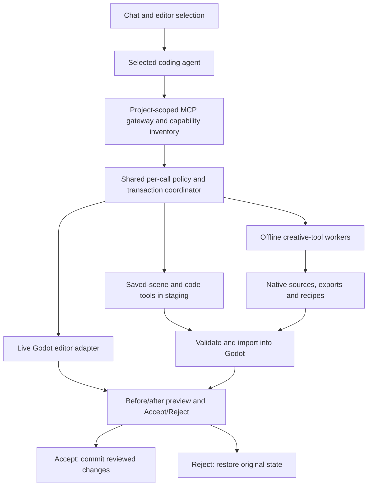

# Joinery implementation map

Audited 2026-11-08 and updated for 0.2.0 on 2026-11-10. The verified workflows
and remaining external verification limits are listed first; the original audit
and delivery criteria are retained below.

The objective is a complete request-to-result workflow: a user describes a
change, the agent operates the owning application, Godot shows the result, and
the user accepts or rejects it. The user should judge creative quality, not
identify missing transports and tool commands through trial and error.

## Implemented and verified

The shared gateway, pinned installs, staged file transactions, source registry,
general live node operations, art-approval binding, native creative-document
operators, provider transports, recovery and source/engine packaging are now
implemented. See [ADR 0017](adr/0017-project-mcp-gateway.md) and the
[recorded checks](../evals/results/project-gateway.md).

| Workflow | Evidence | Current limit |
|---|---|---|
| Real Codex live editor | Create and delete through chat; reject; broad native undo/resource/script/signal tests | Live previews are not auto-saved |
| Pinned MCP discovery | Godot, Blender, Inkscape real inspection; SuperCollider tool discovery | Optional apps/addons require their own installed runtime |
| Saved-file edits | Real offline MCP create/add/reject/accept/read; model-to-gateway regression | The current unsaved scene must use live tools |
| Blender | Native save/GLB export, source-part update, registry resolution, replay/reject; imported Godot instance accepted and reverted | Actual project art direction still needs user approval |
| Krita | Native layered save, PNG export, inspection, semantic source replay/reject | Runs in a disposable offline app, not the user's open desktop document |
| Material Maker | Native graph, real Godot material export, record/replay/reject | Software Vulkan is slower on emulated amd64 |
| SuperCollider | Native patch, NRT WAV, record/replay/reject | Live device routing is separate from NRT asset authoring |
| Other providers | Claude stream transport; Gemini/OpenCode ACP fixtures and read-only host boundary | Claude live check hit quota; Gemini/OpenCode live auth paths need installed CLIs |
| Recovery/distribution | Review conflict and recovery tests, project lease, addon protocol/version checks, manifest bundle | Engine bundles target their built platform |
| New game from a blueprint | `joinery new --blueprint` and `joinery game apply` (the wizard's step) share `joinery/game_setup.py`: addon with its MIT licence, blueprint and features, brief, bible preset, `[game.steam]` and the pinned GodotSteam download; made projects import and run in stock Godot and open in the patched editor without script errors | A failed GodotSteam download leaves Steam calls doing nothing until it is installed |
| Feature add/remove | Staged in a file transaction and reviewed like any change; the game manifest is carried on accept, dropped on reject and restored on revert; `--plan` shows the before and after | Steam and translations follow-ups run only after accept |
| Art bible v2 and game brief | 20-section bible from one schema, reference board, presets per starting point, ten checked rule families measured in Python or in the offline workers, lint and `bible --upgrade`; `design/brief.md` drafted from wizard answers and the real input map ([ADR 0022](adr/0022-art-bible-v2.md), [ADR 0023](adr/0023-game-brief.md)) | The brief suggests features; it never adds them |
| Part selection | `joinery parts` from Blender's own inspection; names mapped back through export extras; typed per-part edits (`set_material_value`, `adjust_map`, `bake_height_to_normal`, `make_map_editable`, `paint_map`, `replace_map`, `split_material`, `edit_bone`, `edit_shape_key`) ([ADR 0028](adr/0028-part-selection.md)); a character's body regions, MPFB2 body settings and the game's shape keys (`set_body_shape`, `bake_shape_keys`), picked on the asset page and in review ([ADR 0073](adr/0073-character-parts-and-shape-keys.md)) | Blender only; Alt+click on stock Godot needs the model root selected |
| Change history | Copy-on-write stage, originals of changed files only, retention under `[history]`, `history usage\|compact` ([ADR 0026](adr/0026-change-history-storage.md)) | Compact gives up older reverts |
| Tool readiness | One core (`joinery/readiness.py`) for CLI, wizard, rail, sidebar and agents; 21 of 21 tool probes pass offline ([results](../evals/results/tools-working.md)) | No authoring round trip in `status` or `doctor` |
| Removed tools | Aseprite, REAPER, MuseScore and Audacity left the catalog; projects that list them keep opening with a notice ([ADR 0025](adr/0025-tool-removals.md)) | They can return only as user-added custom tools |
| Classic Godot view | One editor setting, `interface/joinery/editor_layout` (Joinery or Classic Godot), switched from Editor > Switch to classic Godot view (or Switch to Joinery view), the command palette or Journeyman settings > Appearance > Layout; each layout keeps its own docks in `editor_layout.cfg`; `tests/godot/run_classic_view_test.py` checks docks, title bar, run bar, menu item and settings row in both layouts ([ADR 0031](adr/0031-classic-godot-view.md)) | Applies after a restart; nothing switches live |
| Writing guidance | Bible, brief and agent instructions share `joinery/bible_writing.py`; bible lint and the brief check suggest plainer words for filler | A suggestion only, never a blocker |

This table distinguishes implementation from live verification. Account quotas,
missing optional licensed apps and unapproved art direction are not represented
as successful creative workflows. The original audit below is retained as the
before-state, followed by the delivery acceptance criteria.

## Initial audit, before this implementation

| Area | Actual state | Evidence |
|---|---|---|
| Startup, tool views and previews | Implemented; useful UI groundwork | `godot_addon/joinery/`, native editor tests |
| Agent authentication | Detection/sign-in and API-profile setup exist for several providers | `joinery/connection.py`, `api_profiles.py`, `agent_connect.gd` |
| Agent execution | Codex chat is connected. Claude, Gemini and opencode chat adapters are unimplemented | `bridge/adapters.py` |
| Preferred MCPs | Catalogued and pinned; selection does not install/connect them | `policy/preferred_tools.toml`, `joinery/installer.py:write_mcp_config` |
| Generated MCP configuration | Only explicit custom MCP commands are written to `.mcp.json`; no preferred-server launch generation or per-agent MCP wiring | `joinery/installer.py`, `joinery/wiring.py` |
| Current game | `test-proj/.codex` contains the policy hook; no project `.mcp.json` was present during audit | Read-only filesystem check |
| Current native editing | A separate Codex dynamic tool supports boxes and selected Node3D transforms; deletion is absent | `joinery/editor_ops.py`, `scene_edits.gd` |
| Transactions | Reject and undo/redo work for that narrow scene path. No general file/document/multi-tool transaction coordinator | `scene_edits.gd`, native scene-edit tests |
| First-party MCP packages | All six `servers/*/__init__.py` files are empty placeholders | `servers/` |
| Tool execution and recipes | CLI runners, scratch-copy recipe replay, fingerprints and provenance checks exist; these are not a connected chat-authoring pipeline | `joinery/runner.py`, `recipe.py`, `locking.py`, ADR 0009 |
| Sandbox | Creative-tool image and offline execution have recorded build/round-trip evidence. It does not package the complete agent-facing MCP runtime | `sandbox/Dockerfile`, ADR 0008 and ADR 0009 |
| Art direction | Interview/template writing exists; no machine-checked approval/version gate was found in the inspected path | `joinery/bible.py`, `project_setup.gd` |
| Verification | 297 Python tests and several native integration checks last passed. The full natural-language MCP workflow is not covered by those passes | `evals/results/scene-edits.md`, `tests/` |

“Available” in the tool catalog currently means a preferred source was selected,
not that an installed server has connected and completed a real operation.
`joinery doctor` renders the shared readiness core (`joinery/readiness.py`):
worker images, versions inside the workers and, once cached, MCP probes; it does
not run an authoring round trip. The configuration
check even accepts an absent `.mcp.json`; that is not proof of tool readiness.

## Architecture to build

Keep the existing UI, policy, recipes and working transaction mechanics. Replace
the box-specific agent interface with a capability-based tool path. Reuse
upstream tools where their semantics match the task. Do not write a separate
natural-language handler for a hammer, crate, chair, delete request, etc.

Some primitives and adapters still require implementation. MCP is a transport
and tool interface; it does not supply live-editor synchronization, rollback,
asset ownership or quality checks automatically.

## Delivery order and acceptance checks

### 1. Truthful capability inventory and startup checks

Build a single inventory with distinct states: selected, installed, process
started, MCP connected, tools discovered, operation tested, and temporarily
unavailable. Track the selected provider's authentication separately from its
chat transport and tool connections. Do not label an entire creative workflow
ready just because an executable or account exists.

Extend diagnostics to identify missing server builds, app addons, runtime
versions, stale connections and unavailable operation families. Missing optional
tools should not break unrelated workflows. Inspect capabilities before the
agent promises an edit; show actionable failures in chat and diagnostics in
Output. Preserve the user's selectable custom MCP alternatives.

Acceptance: a clean installation with missing Blender, a crashed server, an
unsupported agent adapter, or stale credentials reports the exact missing piece
before promising a corresponding operation. A successful status includes an
actual handshake and harmless read-only probe, not just a config file.

### 2. Shared MCP runtime and agent wiring

Install/build the selected preferred servers at their recorded revisions;
validate their licenses, dependencies and startup commands. Start, stop,
reconnect and supervise project-owned server processes. Perform MCP initialize,
tool discovery and result/error handling. Keep long-running jobs off the editor
main thread, with native polled pipes or an equivalent tested transport.

Use a Joinery-owned project gateway to preserve server/tool identity, enforce the
shared policy, and coordinate mutating jobs. Agent adapters connect to this same
runtime using each provider's supported interface/configuration. Existing global
user settings and credentials must not be overwritten to achieve this.

Register the currently empty first-party servers only when real entry points and
operations exist. Package their Python/Node dependencies in the execution
runtime. Do not report them ready because their empty packages import.

Acceptance: a fresh project connects to its configured Godot and Blender MCPs,
returns their actual tool lists, and executes real inspection calls through the
selected agent. Cancel/restart leaves no orphan server or worker. Rejected calls
still use the existing allowlist/denylist and Rule Zero behavior.

### 3. Project context and live-editor targeting

Resolve the open project, scene, unsaved state, selected objects/resources,
script/property context and stable identities. Resolve imported resources to
native sources and their owning tool. Reuse the workspace source resolution and
existing stale-request checks; complete registry lookup APIs for model tools.

Distinguish three Godot execution targets explicitly:

- The live editor scene, including unsaved changes.
- Saved project files, edited in staging and merged/reloaded deliberately.
- A running game instance, used for testing and runtime inspection.

The pinned Godot MCP documents headless scene-file tools and a separate game
runtime autoload/TCP interface. Its runtime node deletion is not automatically
live-editor deletion. Extend the Joinery editor adapter where necessary rather
than launching a second game or overwriting an unsaved scene to fake success.

Acceptance: requests target the selected object in the correct editor/project.
Switching scenes, replacing a node at the same path, or concurrent manual edits
cannot redirect an old request to a new object. Unsaved work survives.

### 4. General transactions and worker execution

Generalize the existing scene transaction into a coordinator for files, native
creative documents, imported assets, metadata and live editor changes. Use
isolated staging and record the actual affected state before mutation. Define
ownership, conflict checks, cancellation, timeout cleanup and crash recovery.

Preferred order: inspect -> snapshot -> operate in staging or a reversible live
adapter -> validate -> preview -> accept/reject. Accept promotes the reviewed
changes; reject restores files, document/editor state and source metadata without
clobbering unrelated user edits. Support one transaction across multiple tools.

Offline workers need the real MCP runtime and creative applications, with only
the staged project mounted and no model credentials. Keep the agent/API process
outside the offline worker. Use typed upstream operations first; script fallback
must be sandboxed, logged and attached to the recipe. Do not silently fall back
to an unrestricted host process if the required worker is unavailable.

Acceptance: injected failures during tool execution, save, import and validation
leave the project intact. Reject restores the pre-request state. Existing-scene
undo works for accepted changes; accepted cross-tool changes have a defined
revert strategy. A tool with no supported restoration strategy is reported
honestly before it mutates project state.

### 5. Complete the basic Godot workflow

Expose reusable operation families through the shared tool path: inspect scene
and properties; create/delete/duplicate/reparent/rename nodes; modify properties
and resources; attach/edit/validate scripts; connect signals; save/reload and run
smoke tests. Reuse the preferred server's saved-file operations and implement the
missing live-editor semantics once. Preserve undo, owners, sibling order,
subtrees, resource references and signal connections when restoring deletions.

The agent composes these capabilities for natural-language requests. There is no
new UI command for each phrasing. Keep ordinary scene scaffolding separate from
finished art/audio creation.

Acceptance: the complete create -> select -> move/resize/rotate -> duplicate ->
rename -> delete -> reject -> delete/accept -> undo/redo lifecycle passes through
chat. Also test scripts, resources, signals, unsaved scenes, imported instances,
multi-object requests and save/reopen. A runtime-only mutation must not be
reported as a persistent scene edit.

### 6. Deliver the Blender-to-Godot workflow

Before finished asset work, implement the art-bible approval record tied to the
approved content/version; changing it invalidates approval. The existing blank
or partially filled template is not approval.

Verify and launch the pinned Blender MCP/addon in its supported Blender version.
Its source/license and full runtime behavior need installation-time verification;
the upstream Blender forge was inaccessible during this audit. Use scene/object
inspection, modelling tools and the logged Blender Python fallback rather than
an individual “make hammer” feature.

Add the missing authoring pipeline: stage the native `.blend`, name source
objects/parts, preserve existing sources, record operations, validate units,
transforms/topology/materials, save/export, trigger Godot import, and place or
update the intended scene instance. Record the recipe and measured provenance;
compare exports semantically where bytes are not deterministic. Reuse the
existing recipe/fingerprint/rebuild infrastructure.

Acceptance: after art direction is approved, “create a low-poly hammer” makes a
real Blender document, imports a visible object into Godot, and presents a review.
“Make its handle longer” edits that source and updates the same instance. Reject
restores it; accept survives restart; rebuilding its recipe reproduces the asset.
The hammer, crate and similar props use the same modelling integration.

### 7. Add materials, 2D and audio integrations

Use the shared runtime, transactions, source registry and import handling for
Material Maker, Krita (pixel art included) and SuperCollider/Surge XT/MIDI audio tools. Each application
still needs its own document, operation, preview/export and replay adapter.
Material Maker/Krita/Surge currently have planned catalog entries; their
first-party servers are not implemented. Paid or desktop-only apps (Aseprite,
REAPER, MuseScore, Audacity) were removed as built-in tools (ADR 0025).

Acceptance examples: alter an existing material graph and reimport it; edit a
sprite layer and refresh its Godot resource; change a synth patch and compare
before/after audio. Every example has correct source ownership, replay/provenance
and clean rejection. Existing waveform/3D/image widgets can be reused for review.

### 8. Provider parity, recovery and distribution

Implement Claude Code, Gemini and opencode execution adapters against the same
tools and transactions, not separate app-specific feature sets. Test their actual
subscription/API authentication paths, model endpoints, streaming, stop/reconnect
and shared policy enforcement. Run the same capability suite for each provider.

Package a reproducible engine/addon/server installation and managed updates so
an old copied addon cannot silently keep an obsolete tool schema/session. Add
crash diagnostics with matching build symbols, recoverable transaction journals,
connection loss handling, project switching and startup/reopen tests. Keep plain
Godot compatibility. CI should run the real native editor checks as well as
Python tests.

Acceptance: a fresh install can authenticate, create/open a project, connect
required tools, finish and reject representative edits, restart, and reopen its
sources without manual config repair. Provider support is advertised only after
that provider's path passes.

## How we stop using the user as the test suite

Maintain a capability/acceptance matrix with recorded outcomes, not one test
count. For every advertised mutating family require create/read/update/delete
where meaningful, clean reject, accept persistence, undo or documented revert,
concurrent-edit protection and cancel/crash handling.

Use three kinds of evidence:

1. Deterministic protocol/policy/transaction tests for edge cases and restoration.
2. Real installed applications and native Godot integration tests, including
   imports, save/reopen and process lifecycle. Check stderr/script errors even if
   the application returns exit code zero.
3. A recorded model-driven request suite through the actual chat UI. Cover
   create/edit/delete chains, multiple objects, follow-up references, imported
   assets and unsupported requests. Verify resulting scene/source state, not just
   the agent's words. Keep subjective artistic quality review separate from
   these objective checks.

A regression from either screenshot belongs in the permanent suite: create a
box, then remove that same selected box. This must pass before calling the core
Godot editing workflow ready. For Blender, the equivalent is hammer creation,
source modification, reimport, rejection and reopen/replay.

The first useful delivery target is steps 1–5 for reliable general Godot editing,
then step 6 for the full modelling workflow. Other apps and providers follow the
same core. The user supplies creative direction/approval and judges results;
connection failures and missing basic commands are implementation/test work.

## References and implementation anchors

- Current catalog: [preferred_tools.toml](../policy/preferred_tools.toml).
- MCP selection/config gap: [installer.py](../joinery/installer.py),
  [wiring.py](../joinery/wiring.py), [doctor.py](../joinery/doctor.py).
- Current transport and narrow operations: [bridge](../bridge/),
  [editor_ops.py](../joinery/editor_ops.py),
  [scene_edits.gd](../godot_addon/joinery/scene_edits.gd).
- Existing replay and provenance: [ADR 0009](adr/0009-recipes-and-round-trips.md),
  [recipe.py](../joinery/recipe.py), [locking.py](../joinery/locking.py).
- The catalog-pinned [Godot MCP README](https://github.com/tugcantopaloglu/godot-mcp/blob/88f0fbc69a08225d4fdec32f921209e127f52395/README.md)
  documents saved-scene operations and the separate running-game channel.
- The catalog-pinned [Blender MCP source](https://projects.blender.org/lab/blender_mcp/src/commit/2cea8d566dde07fbac28a61d698909d69724e853)
  initially returned 403 over the forge's browser interface. Its Git source was
  subsequently retrieved at the exact pin; installation, native inspection,
  authoring and replay were independently exercised.
